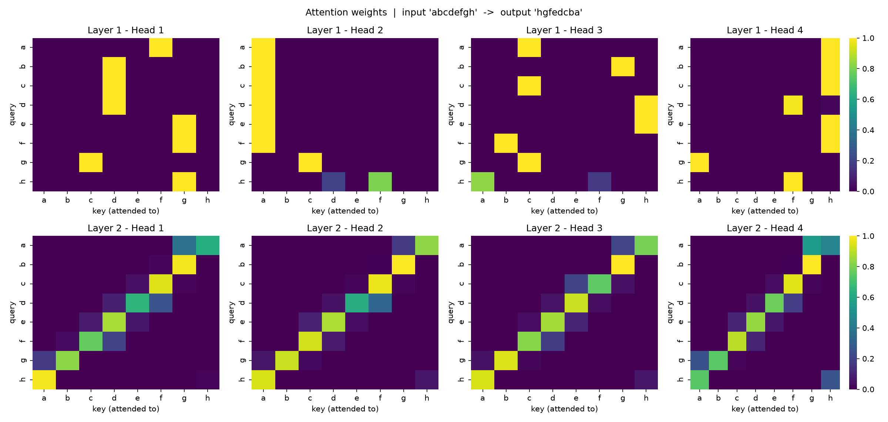
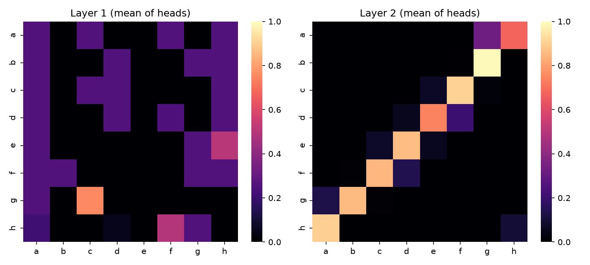

# Transformer Attention from Scratch

A from-scratch PyTorch implementation of **scaled dot-product attention** and **multi-head self-attention**, assembled into a small transformer and trained on a **sequence-reversal** task (`hello` → `olleh`). Attention weights are visualized to show what the model learned to focus on.

No built-in attention is used: neither `nn.MultiheadAttention` nor `F.scaled_dot_product_attention`. Only `nn.Linear`, `torch.matmul`, and `softmax`.

---

## Table of Contents
1. [Highlights](#highlights)
2. [Project Structure](#project-structure)
3. [Installation](#installation)
4. [Usage](#usage)
5. [Implementation Details](#implementation-details)
6. [Experiment Setup](#experiment-setup)
7. [Results](#results)
8. [What the Model Learned](#what-the-model-learned)
9. [Limitations and Future Work](#limitations-and-future-work)

---

## Highlights
- Scaled dot-product attention with **causal** and **padding** mask support
- **Multi-head self-attention** (split heads → attend → concatenate → output projection)
- Full **transformer block**: attention, residual + LayerNorm, feed-forward, residual + LayerNorm
- **Sinusoidal positional encoding**
- Attention heatmaps for every layer and head, plus a quantitative "mirror attention" score
- Reaches **99.72% validation token accuracy** on the reversal task

---

## Project Structure

```
Transformer/
├── attention.py          # Scaled dot-product attention, masks, multi-head self-attention
├── transformer.py        # Positional encoding, feed-forward, transformer block, full model
├── data.py               # Sequence-reversal dataset (26 letters, length 8)
├── train.py              # Training loop, validation, loss/accuracy curves
├── visualize.py          # Attention heatmaps and mirror-position scores
├── requirements.txt      # Python dependencies
├── README.md             # Project documentation
├── model.pt              # Trained model weights (generated by train.py)
└── images/               # Generated visualizations
    ├── training_curves.png
    ├── attention_heatmaps.png
    └── attention_mean_per_layer.png
```

| File | Responsibility |
|---|---|
| `attention.py` | `scaled_dot_product_attention`, `causal_mask`, `padding_mask`, `MultiHeadSelfAttention`. Running the file executes sanity checks. |
| `transformer.py` | `PositionalEncoding`, `FeedForward`, `TransformerBlock`, `SmallTransformer`. |
| `data.py` | Generates random letter sequences and their reversed targets. |
| `train.py` | Trains with Adam and cross-entropy, saves `model.pt` and the training curves. |
| `visualize.py` | Loads `model.pt`, plots per-head and per-layer attention, prints mirror-attention scores. |

---

## Installation

```bash
# 1. Create and activate a virtual environment (Windows)
python -m venv venv
venv\Scripts\activate

# 2. Install dependencies
pip install -r requirements.txt
```

**Requirements:** Python 3.9+, `torch`, `numpy`, `matplotlib`, `seaborn`, `tqdm`. The project trains in minutes on CPU, so a GPU is not required.

---

## Usage

```bash
python attention.py    # sanity checks: shapes, softmax rows sum to 1, causal mask
python train.py        # trains the model, saves model.pt and images/training_curves.png
python visualize.py    # saves attention heatmaps to images/
```

---

## Implementation Details

### 1. Scaled Dot-Product Attention
```
Attention(Q, K, V) = softmax(Q Kᵀ / √d_k) · V
```
Every token produces a **query** (what it looks for), a **key** (what it offers), and a **value** (the information it carries). Query-key similarity gives weights, and the output is a weighted sum of values, so any token can read directly from any other position.

**Why divide by √d_k?** Dot-product magnitudes grow with the dimension. Without scaling, softmax saturates into near one-hot distributions with vanishing gradients. Scaling keeps the scores in a stable range.

### 2. Masking
- **Padding mask:** hides padding tokens.
- **Causal mask:** lower-triangular, so position *i* only sees positions ≤ *i* (needed for text generation).

Blocked scores are set to `-inf` before softmax, giving them exactly zero weight. Reversal uses full (unmasked) attention.

### 3. Multi-Head Self-Attention
The embedding (`d_model`) is split into `h` heads, each with its own Q/K/V projections in a smaller subspace. Heads can specialize in different patterns. Their outputs are concatenated and mixed by a final linear layer `W_o`.

### 4. Positional Encoding
Attention is permutation-invariant, so order has to be injected. Sinusoidal encodings add a unique, smoothly varying signal per position. This is essential for reversal, where the model must know *where* each token sits.

### 5. Residual Connections and LayerNorm
Residual paths give gradients a direct route and let each layer refine instead of replace its input. LayerNorm stabilizes activations. The block uses post-LN, as in the original paper.

### 6. Feed-Forward Network
A per-token MLP (`Linear → GELU → Dropout → Linear`) adds non-linear processing after tokens have exchanged information via attention.

### Block Architecture
```
Input embeddings + positional encoding
        │
        ├──► Multi-Head Self-Attention ──┐
        └────────────── residual ────────┴─► Add & LayerNorm
        │
        ├──► Feed-Forward Network ───────┐
        └────────────── residual ────────┴─► Add & LayerNorm
        │
   (repeat × n_layers)
        │
   Linear → vocabulary logits
```

---

## Experiment Setup

| Setting | Value |
|---|---|
| Task | Sequence reversal |
| Vocabulary | 26 lowercase letters |
| Sequence length | 8 |
| Train / validation samples | 20,000 / 2,000 |
| `d_model` | 64 |
| Attention heads | 4 |
| Feed-forward dimension | 128 |
| Transformer layers | 2 |
| Dropout | 0.1 |
| Optimizer | Adam, learning rate 2e-3 |
| Batch size / epochs | 128 / 30 |
| Loss | Cross-entropy over all positions |

---

## Results

| Metric | Value |
|---|---|
| Final training loss (epoch 30) | **0.0224** |
| Final validation token accuracy | **99.72%** |

**Example prediction**

| Input | Model output | Expected |
|---|---|---|
| `abcdefgh` | `hgfedcba` | `hgfedcba` |
| `qwertyui` | `iuytrewq` | `iuytrewq` |

**Training curves**


**Attention heatmaps (every layer and head)**



**Attention averaged over heads, per layer**



---

## What the Model Learned

In reversal, output position `i` must copy the input token at position `L-1-i`, so a model that solves it has to route information along the **anti-diagonal** of the attention matrix. The heatmaps for the test input `abcdefgh` (output `hgfedcba`, correct) show this clearly, but only in the second layer.

**1. Layer 2 performs the reversal.** All four heads show a clean anti-diagonal: `a→h`, `b→g`, `c→f`, `d→e`, `e→d`, `f→c`, `g→b`, `h→a`. In the head-averaged map, queries `b`, `c`, `e`, `f`, `g` and `h` put roughly 0.85 to 1.0 of their weight on their mirror position. The edge and middle rows are slightly blurred: `a` splits between `h` (about 0.6) and `g` (about 0.3), and `d` splits between `e` (about 0.75) and `f`.

**2. Layer 1 is sharp but not mirror-like.** Layer 1 heads put almost all their weight on a single key per query, but the choices look irregular. Head 2 sends most queries to the first token (`a`), Head 4 sends most to the last token (`h`), and Heads 1 and 3 scatter across a few keys. There is no anti-diagonal here. A plausible interpretation (not proven by these plots alone) is that layer 1 gathers and mixes token and positional information, and layer 2 then uses it to look up the mirror position.

**3. Layer 2 heads are redundant, not specialized.** All four heads learn the same pattern. This is common in small models trained on a task with one simple rule: there is no pressure to split the work across heads.

**4. The result holds on a different input.** Running `visualize.py` on `qwertyui` also gives the correct reversal (`iuytrewq`). Layer 2 mirror-attention stays between about 0.80 and 0.90 for every head on both inputs, so the lookup depends on position, not on which letters appear. Layer 1 scores change with the input and sit near 0.125 to 0.25. With 8 positions, 0.125 (1/8) is what a head that attends to one key per query would score by chance, so layer 1 is not doing mirror attention.

| Layer | Head | Mirror score (`abcdefgh`) | Mirror score (`qwertyui`) | Observed pattern (`abcdefgh`) |
|---|---|---|---|---|
| 1 | 1 | 0.000 | 0.250 | Sparse, one key per query (mostly `d` and `g`); no mirror structure |
| 1 | 2 | 0.000 | 0.248 | Most queries (`a` to `f`) attend to the first token `a` |
| 1 | 3 | 0.229 | 0.125 | Scattered one-hot attention; no clear structure |
| 1 | 4 | 0.125 | 0.250 | Most queries attend to the last token `h` |
| 2 | 1 | 0.831 | 0.839 | Anti-diagonal (mirror position) |
| 2 | 2 | 0.885 | 0.851 | Anti-diagonal, sharpest of the four |
| 2 | 3 | 0.879 | 0.883 | Anti-diagonal |
| 2 | 4 | 0.798 | 0.895 | Anti-diagonal, slightly more diffuse at the edges |

The heatmaps shown above are for the input noted in each image title. Mirror scores are the mean attention each head places on the mirror position, printed by `python visualize.py`.

---|---|---|
| 1 | 1 | Sparse, one key per query (mostly `d` and `g`); no mirror structure |
| 1 | 2 | Most queries (`a` to `f`) attend to the first token `a` |
| 1 | 3 | Scattered one-hot attention (`c`, `g`, `h`, `b`); no clear structure |
| 1 | 4 | Most queries attend to the last token `h` |
| 2 | 1 | Anti-diagonal (mirror position) |
| 2 | 2 | Anti-diagonal (mirror position), sharpest of the four |
| 2 | 3 | Anti-diagonal (mirror position) |
| 2 | 4 | Anti-diagonal (mirror position), slightly more diffuse at the edges |

Exact per-head mirror-attention scores are printed by `python visualize.py`.

---

## Limitations and Future Work
- Fixed sequence length (8); variable lengths would use the padding mask.
- Encoder-only model; a full encoder-decoder with causal masking is a natural extension.
- Possible follow-ups: character-level text generation with the causal mask, learned positional embeddings, and comparing head counts or depths.

---

## Author
**Muhammad Faizan Farooq**, Machine Learning & AI Engineer
GitHub: [faizanjutt473](https://github.com/faizanjutt473)
